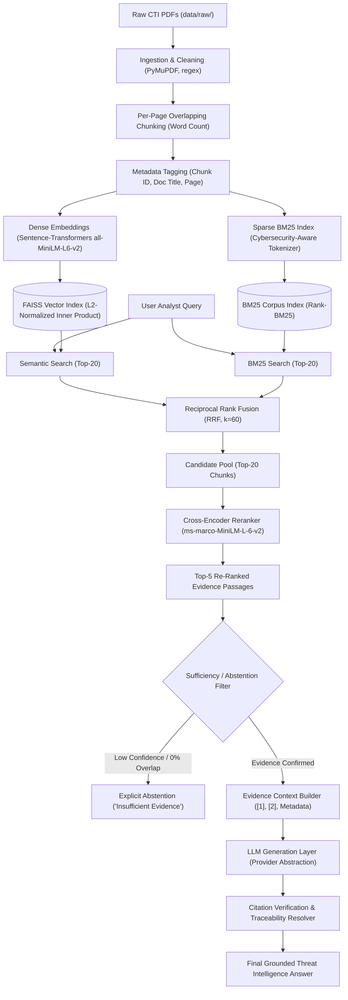

# System Architecture: Cybersecurity Threat Intelligence RAG

## 1. Overview & Research Scope
This project implements an evidence-grounded **Retrieval-Augmented Generation (RAG)** system designed specifically for Cyber Threat Intelligence (CTI) report analysis. It automates information extraction from complex, unstructured security PDF reports (IOCs, TTPs, actor attribution, vulnerabilities, malware mechanics) while enforcing strict evidence grounding, citation traceability (`[1]`, `[2]`), and explicit abstention on unanswerable queries.



---

## 2. Ingestion & Preprocessing Subsystem
- **PDF Extraction**: Extracted using `PyMuPDF` (`fitz`), preserving page numbers so that every chunk carries an unambiguous, traceable page origin.
- **Cleaning**: Strips recurring headers, footers, page numbering artifacts, and excessive whitespace.
- **Chunking**: Page-bounded overlapping chunking (`CHUNK_SIZE_WORDS = 250`, `CHUNK_OVERLAP_WORDS = 40`, `MIN_CHUNK_WORDS = 30`). Chunks never span across multiple pages, guaranteeing precise citation mapping.
- **Structured Metadata**: Every chunk includes:
  - `chunk_id`: `{document_id}_p{page_number}_c{chunk_index}`
  - `document_id` and `document_title`
  - `page_number` and `chunk_index`
  - `source`: `local_pdf`
  - `text`: Cleaned text passage

---

## 3. Dual-Stage Retrieval & Fusion Architecture

### 3.1 Sparse Retrieval (BM25)
- Implemented with `rank_bm25.BM25Okapi`.
- **Cybersecurity-Aware Tokenizer**: Uses regular expression `[A-Za-z0-9][A-Za-z0-9._-]*` to keep technical identifiers intact (e.g. `CVE-2023-24955`, `T1003.001`, `192.168.1.1`, `powershell.exe`, `domain.com`) as single tokens rather than shattering them on punctuation.

### 3.2 Dense Semantic Retrieval (FAISS)
- Model: `sentence-transformers/all-MiniLM-L6-v2` (384-dimensional dense vectors).
- Vectors are L2-normalized upon indexing, enabling exact cosine similarity computation via FAISS inner-product (`IndexFlatIP`).

### 3.3 Hybrid Fusion (Reciprocal Rank Fusion — RRF)
Because BM25 scores (unbounded) and cosine similarity scores ($-1 \dots 1$) live on incompatible scales, raw score addition causes arbitrary domination. RRF fuses by rank position:
$$\text{RRF Score}(d) = \sum_{m \in \{\text{dense}, \text{sparse}\}} \frac{1}{k + \text{rank}_m(d)}$$
with smoothing constant $k = 60$.

### 3.4 Cross-Encoder Reranking
- Top 20 hybrid candidates are jointly evaluated with the query using `cross-encoder/ms-marco-MiniLM-L-6-v2`.
- Full cross-attention attends across query terms and passage tokens simultaneously, resolving lexical mismatch and semantic nuance before passing the top 5 results to generation.

---

## 4. Evidence Context Construction & Citation Mapping
- Chunks are assembled into a structured evidence prompt:
  ```text
  [1] Source Document: {document_title} (ID: {doc_id}) | Page: {page_number} | Chunk ID: {chunk_id} | Score: {score}
  Content:
  {passage_text}
  ```
- Bidirectional citation map `{1: chunk_1, 2: chunk_2, ...}` is maintained.
- Citations in the generated answer (e.g., `[1]`, `[2]`) are parsed, validated against the evidence pool, and verified for non-phantom validity.

---

## 5. Abstention & Anti-Hallucination Gating
To prevent hallucination on out-of-corpus queries:
1. **Target Identifier Gating**: If a query explicitly names an identifier (e.g., a specific CVE, MITRE technique, or specific malware) not present in the retrieved evidence, the system abstains.
2. **Keyword Coverage Gating**: Requires that at least 55% of the query's informative content words appear within the retrieved evidence.
3. **Cross-Encoder Score Thresholding**: Rejects candidates scoring below the minimum threshold.
4. **Standard Abstention Message**:
   > *"I do not have sufficient evidence in the ingested threat intelligence reports to answer this question."*

---

## 6. Provider-Independent LLM Abstraction
- Defined in `backend/generation/llm.py` via `BaseLLMProvider`.
- **`OfflineExtractiveLLMProvider`**: Deterministic, local extractive synthesis allowing 100% offline, reproducible testing and evaluation without API keys or costs.
- **`OpenAICompatibleProvider`**: Connects to OpenAI (`gpt-4o-mini`), Groq (`llama-3.1-70b`), OpenRouter, or vLLM via standard HTTP REST calls (`requests`).
- **`GeminiProvider`**: Connects to Google Gemini API (`gemini-1.5-flash`).
- **`OllamaProvider`**: Connects to local self-hosted Ollama instances.
- Configured via `.env` without hardcoded keys.
